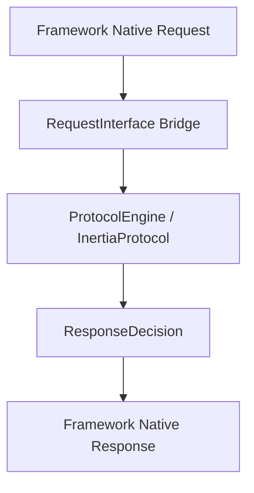

# Building Framework Adapters

`Inertia Protocol Engine for PHP` is specifically designed to be the foundational engine for framework adapters.

---

## Anatomy of an Adapter

An Inertia framework adapter needs to handle only three responsibilities:

1. **Request Bridge**: Implement `Inertia\Protocol\Contracts\RequestInterface` to expose the framework's HTTP request headers and method to the engine.
2. **Facade / Service**: Provide a convenient syntax for controllers (e.g. `Inertia::render('Component', $props)`).
3. **Response Converter**: Transform the engine's `ResponseDecision` into the framework's native response object.

---

## General Lifecycle Pattern

### Response Mapping Matrix:

| Decision State | Native Framework Response Action |
| :--- | :--- |
| **`$decision->isJson()`** | Return a JsonResponse with `$decision->statusCode`, `$decision->headers`, and `$decision->content`. |
| **`$decision->isConflict()`** | Return a Response with status `409` and `$decision->headers`. |
| **`$decision->isRedirect()`** | Return a RedirectResponse to `$decision->content` with status `302` or `303` and `$decision->headers`. |
| **`$decision->isPrecognition()`**| Return a Response with status `204` and `$decision->headers`. |
| **`$decision->isHtml()`** | Render the root framework view (`app.blade.php`, `app.twig`, `app.php`) embedding `$decision->toHtml('app')`. |
