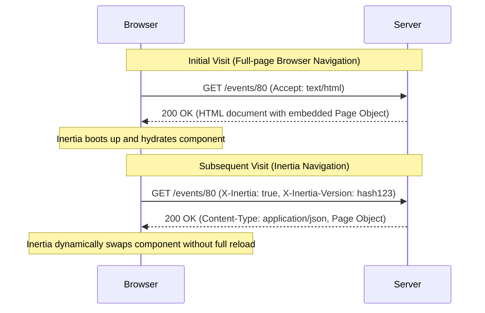

# The Protocol Lifecycle

The Inertia protocol defines how the backend server communicates with the client-side SPA framework (React, Vue, Svelte).

---

## Request Lifecycle Overview



---

## 1. Initial Page Visits (HTML Responses)

The very first request a user makes to an Inertia application (e.g. typing a URL into the browser address bar or clicking an external link) is a standard browser navigation without any Inertia-specific headers:

* **Request**: Standard `GET` request with `Accept: text/html, application/xhtml+xml`.
* **Server Action**: The server answers with a complete HTML document including `<head>` assets (CSS, JS) and mounting elements.
* **Page Object Embedding**:
  * **Inertia v3**: The JSON-encoded page object is stored inside a `<script data-page="app" type="application/json">` tag, and the mounting element is `<div id="app"></div>`.
  * **Inertia v2**: The JSON-encoded page object is stored inside the `data-page` attribute of `<div id="app" data-page="..."></div>`.

The Inertia client boots from this payload immediately, rendering the view without a secondary network request.

---

## 2. Subsequent Navigation (Inertia JSON Responses)

Once Inertia has booted, all subsequent page visits, form submissions, and data reloads happen asynchronously via `fetch` or `XMLHttpRequest`:

* **Request**: Inertia adds the `X-Inertia: true` header to indicate an internal navigation.
* **Server Action**: When the server detects `X-Inertia: true`, it short-circuits and returns the **Page Object** as a JSON response with status `200 OK`:
  ```http
  HTTP/1.1 200 OK
  Content-Type: application/json
  Vary: X-Inertia
  X-Inertia: true
  ```
* **Client Action**: Inertia receives the JSON, updates browser history state (`history.pushState`), and seamlessly swaps the active page component.

---

## 3. Control Responses (409 Conflict)

Inertia uses `409 Conflict` as a control signal to tell the client router to navigate rather than render a page component:

* **Asset Version Mismatch**: Sent on a `GET` request when the client's asset version does not match the server's asset version. Accompanied by `X-Inertia-Location: <url>` and `X-Inertia-Version: <new_version>`. The client performs a hard `window.location` reload to fetch updated assets.
* **External Redirect**: When an action redirects to an external site outside the Inertia application, the server responds with a `409 Conflict` and `X-Inertia-Location: <url>`.
* **URL Fragment Redirect**: When redirecting to a URL containing a fragment/anchor (`#section`), standard browser XHR redirects strip the fragment. The server returns `409 Conflict` with `X-Inertia-Redirect: <url>`, and Inertia initiates a new `GET` visit to that exact URL with the fragment intact.
